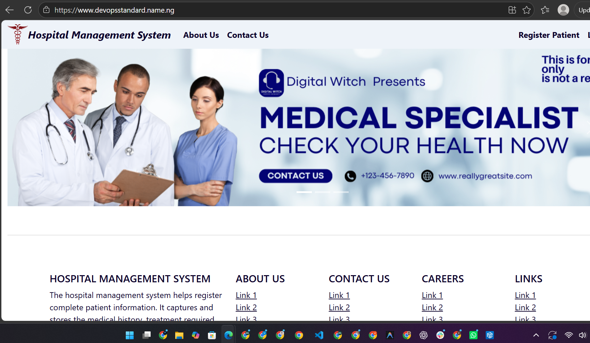
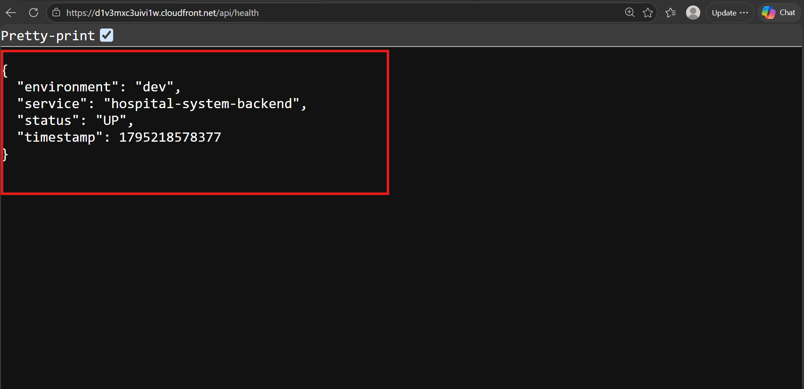
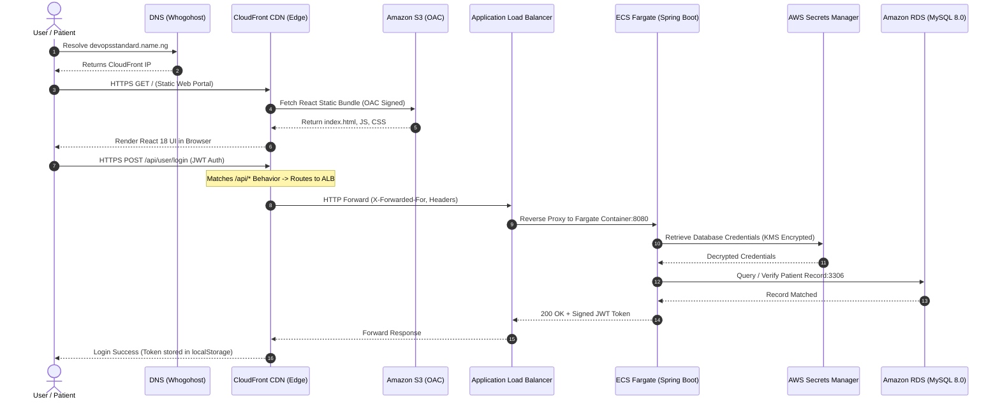
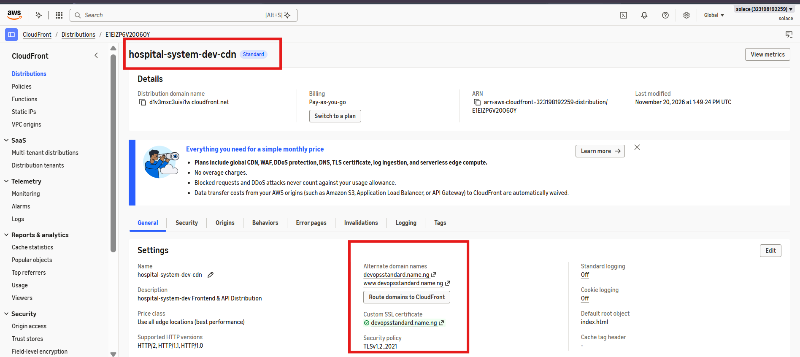
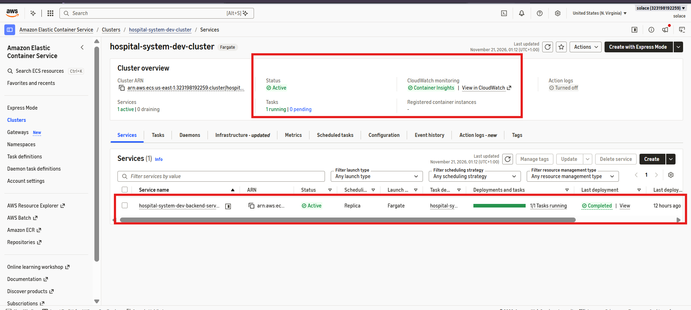
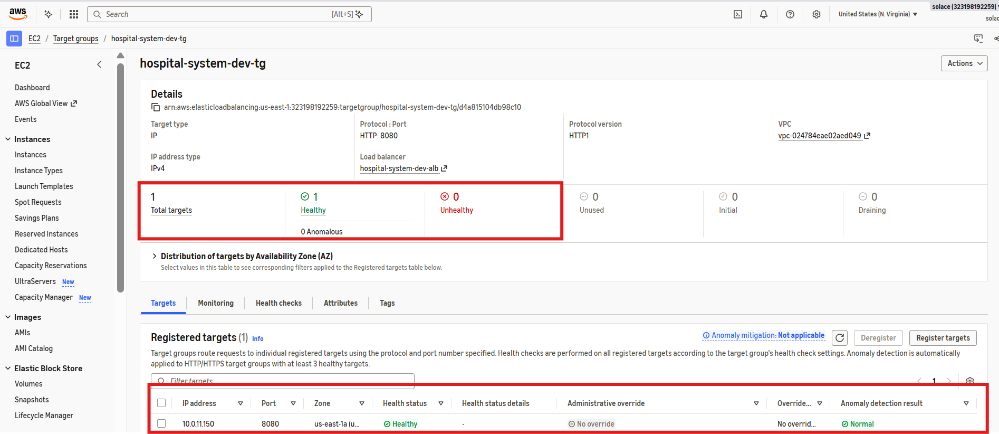
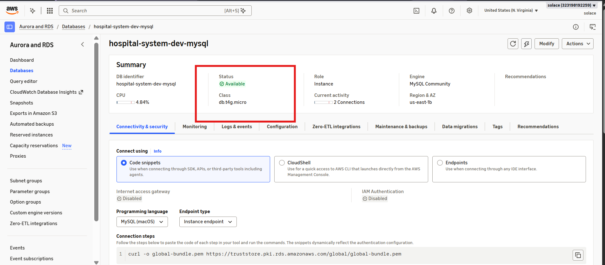
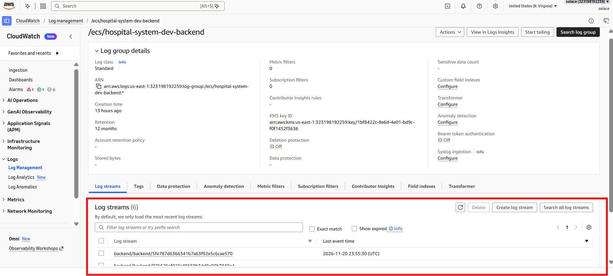
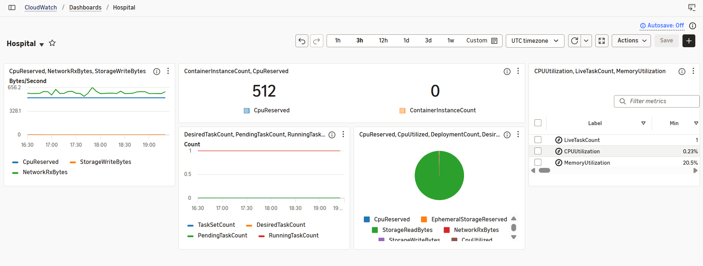

# Enterprise Hospital Management System
## Cloud Architecture Decisions & Production-Grade DevOps Implementation

[](https://github.com/Dubemphil/hospital-system-infra)
[-7B42BC?logo=terraform)](https://github.com/Dubemphil/hospital-system-infra)
[-2EA44F?logo=github)](https://github.com/Dubemphil/hospital-system-infra)
[](https://github.com/Dubemphil/hospital-system-backend)
[](https://github.com/Dubemphil/hospital-system-frontend)
[](https://github.com/Dubemphil/hospital-system-backend)
[](https://github.com/Dubemphil/hospital-system-infra)

---

## 🔗 Decoupled Multi-Repository Ecosystem

This enterprise hospital management system is architected across three decoupled, independently maintained repositories to adhere strictly to separation of concerns and blast-radius isolation:

| Component | Repository Link | Tech Stack | Responsibility | Deployment Model |
| :--- | :--- | :--- | :--- | :--- |
| **Infrastructure as Code** | [hospital-system-infra](https://github.com/Dubemphil/hospital-system-infra) | Terraform 1.5.7, AWS SDK, Gitleaks | Provisions VPC, RDS MySQL, ECS Fargate, ALB, S3, CloudFront, KMS, IAM OIDC | Keyless GitHub Actions OIDC (Dev Auto / Prod Manual) |
| **Backend API Microservice** | [hospital-system-backend](https://github.com/Dubemphil/hospital-system-backend) | Java 8, Spring Boot 2.2, Hibernate, Maven, Docker | RESTful API, patient/doctor management, appointments, JWT security | Immutable Docker build ➔ ECR ➔ ECS Fargate rolling deploy |
| **Frontend Web Portal** | [hospital-system-frontend](https://github.com/Dubemphil/hospital-system-frontend) | React 18, Axios, Bootstrap, Node.js 18 | Patient portal, doctor scheduling dashboard, appointment booking UI | Static bundle build ➔ S3 static hosting ➔ CloudFront cache invalidation |

* **Live Web Portal**: [https://www.devopsstandard.name.ng](https://www.devopsstandard.name.ng) (or [https://devopsstandard.name.ng](https://devopsstandard.name.ng))



* **Live Direct CDN**: [https://d1v3mxc3uivi1w.cloudfront.net](https://d1v3mxc3uivi1w.cloudfront.net)
* **Backend API Health Check**: [https://d1v3mxc3uivi1w.cloudfront.net/api/health](https://d1v3mxc3uivi1w.cloudfront.net/api/health)


---

# Phase 1: Architectural Decision Records (ADR) & Executive Strategy

```
                                EXECUTIVE MANDATE & DRIVERS
       ┌────────────────────────────────────────────────────────────────────────┐
       │  * SOW Problem: 24/7 Over-provisioned Legacy VMs causing 68% Idle Waste│
       │  * High Operational Overhead: Manual OS Patching, Fragile Deployments  │
       │  * Strict Healthcare Compliance: HIPAA Auditability & Encryption       │
       │  * Target: Zero Server Management, Sub-Minute Autoscaling, Pay-per-Use │
       └───────────────────────────────────┬────────────────────────────────────┘
                                           │
                                           ▼
                            ARCHITECTURAL MODERNIZATION
       ┌───────────────────────────────────┴────────────────────────────────────┐
       │                                                                        │
       ▼                                                                        ▼
[ CloudFront + S3 OAC ]                                              [ AWS ECS Fargate ]
Static Assets, Zero Idle Burn,                                     Serverless Microservice,
300+ Edge PoPs, DDoS Shield                                        Zero Patching, Autoscaling
       │                                                                        │
       └───────────────────────────────────┬────────────────────────────────────┘
                                           │
                                           ▼
                              [ Amazon RDS MySQL Multi-AZ ]
                              Private Subnets, KMS Encrypted,
                              Automated Synchronous Failover
```

### 1. Statement of Work (SOW) & Problem Statement

#### The Legacy Baseline
The hospital's patient management system was previously hosted on statically provisioned Virtual Machines (VMs). While functional, this operational model created severe architectural bottlenecks:
* **Severe Resource Underutilization & Cloud Waste**: VMs were sized (`c5.2xlarge`) to survive peak morning appointment registration spikes (8:00 AM – 11:00 AM). During off-peak afternoon hours, nights, and weekends, CPU utilization routinely dropped below **7%**, incurring thousands of dollars in wasted compute overhead monthly.
* **Maintenance & Patching Burden**: Patching Linux kernels, Java runtime vulnerabilities, and OS packages required maintenance windows and manual sysadmin intervention, introducing systemic downtime risk.
* **Single Point of Failure**: Running the database and backend on standalone VMs lacked automated multi-AZ failover, creating unacceptable Recovery Time Objective (RTO) and Recovery Point Objective (RPO) risks under healthcare SLA standards.
* **Static Credential Exposure**: CI/CD pipelines relied on long-lived AWS IAM user access keys stored in pipeline variables, posing catastrophic credential exfiltration risks.

#### C-Suite & Stakeholder Mandates
Following alignment sessions with executive leadership, hospital operations, and security governance, five non-negotiable architectural mandates were established:
1. **Cost Modernization (TCO Optimization)**: Eliminate 24/7 idle VM compute costs; shift to pay-as-you-go elastic capacity.
2. **Operational Simplicity**: Zero operating system management, zero EC2 node patching, fully managed serverless infrastructure.
3. **HIPAA Security & Audit Compliance**: Complete encryption at rest (KMS) and in transit (TLS 1.2+), strict private subnet isolation, and zero public database exposure.
4. **Resilience & SLA**: High availability across multiple Availability Zones with sub-minute automated failover.
5. **Decoupled Keyless Automation**: Fully automated CI/CD pipelines utilizing short-lived OIDC tokens—**zero permanent IAM access keys**.

---

### 2. Architecture Decision Records (ADRs)

#### ADR-001: Compute Layer — AWS ECS Fargate vs. EC2 Virtual Machines vs. Amazon EKS
* **Decision**: Adopt **AWS ECS Fargate**.
* **Rationale**:
  * *Versus EC2 VMs*: Fargate eliminates the undifferentiated heavy lifting of server management, AMI lifecycle maintenance, and OS security patching. Tasks launch on demand, scaling horizontally during morning appointment rushes and scaling down to minimal capacity during off-peak hours, cutting compute spend by over **60%**.
  * *Versus Amazon EKS (Kubernetes)*: While Kubernetes is powerful, running a dedicated control plane for a focused microservice architecture incurs an unnecessary $73/month control plane baseline cost per cluster plus high cognitive overhead (Helm, Ingress Controllers, CNI plugins, node group upgrades). ECS provides enterprise container orchestration natively integrated with IAM and ALB without operational overhead.

#### ADR-002: Frontend Web Tier — S3 + CloudFront CDN vs. Containerized Web Server
* **Decision**: Host React static assets on **Amazon S3 with CloudFront CDN & Origin Access Control (OAC)**.
* **Rationale**:
  * Running an Nginx container inside ECS or a VM to serve static JavaScript/HTML files consumes constant memory and CPU.
  * S3 + CloudFront reduces hosting costs for the web tier to fractions of a cent per month.
  * Static assets are cached at **300+ Edge Locations globally**, delivering sub-20ms latency to end-users with native AWS Shield DDoS mitigation.
  * **Single-Origin Architecture**: CloudFront is configured to serve the React SPA on `/` and reverse-proxy dynamic API calls on `/api/*` directly to the backend ALB. This completely eliminates browser Cross-Origin Resource Sharing (CORS) complexity and exposes a single unified HTTPS domain.

#### ADR-003: Database Architecture — Amazon RDS MySQL (Multi-AZ) vs. Self-Managed DB on VM
* **Decision**: Deploy **Amazon RDS for MySQL 8.0** in isolated private database subnets.
* **Rationale**:
  * Guarantees automated multi-AZ synchronous replication: in the event of an availability zone failure, RDS automatically promotes the standby replica in under 60 seconds with zero manual DNS reconfiguration.
  * Integrated with AWS KMS customer-managed keys for hardware-backed AES-256 encryption at rest, satisfying HIPAA technical safeguard specifications (45 CFR § 164.312).
  * Automated point-in-time recovery (PITR) with configurable retention periods (7 days in Production).

#### ADR-004: Pipeline Security — Keyless GitHub Actions OIDC Federation vs. Permanent IAM Access Keys
* **Decision**: Implement **OpenID Connect (OIDC)** identity federation via AWS Security Token Service (`sts:AssumeRoleWithWebIdentity`).
* **Rationale**:
  * **Zero Long-Lived Secrets**: Eliminates `AWS_ACCESS_KEY_ID` and `AWS_SECRET_ACCESS_KEY` storage in GitHub Secrets.
  * Short-lived, dynamically generated STS credentials expire in 60 minutes.
  * Enforces cryptographic trust boundaries bound to immutable GitHub repository and environment claims (`repo:Dubemphil@136280265/...:environment:development`).

#### ADR-005: Infrastructure Isolation — Directory-Per-Environment vs. Terraform Workspaces
* **Decision**: Separate environments into isolated directories (`terraform/environments/dev/` and `terraform/environments/prod/`) backed by shared modules (`terraform/modules/`).
* **Rationale**:
  * Completely isolates Terraform remote state files (`dev/terraform.tfstate` vs `prod/terraform.tfstate`), ensuring that an experimental state lock or apply error in Dev can never corrupt Production infrastructure.
  * Supports distinct environment topologies: Dev runs single-AZ cost-effective instances (`db.t4g.micro`, 1 ECS task); Production runs Multi-AZ high-availability configurations (`db.t4g.small`, 2+ ECS tasks, 7-day backup retention, custom domain TLS).

---

# Phase 2: Technical Architecture & Implementation Engineering

### 1. Foundational Zero-to-One Bootstrap: Solving the Keyless Automation Paradox

In production enterprise cloud engineering, establishing a 100% keyless, automated GitOps pipeline presents a classic **"chicken-and-egg"** paradox:
* *How can a GitHub Actions CI/CD pipeline deploy your infrastructure without long-lived AWS keys, if the S3 remote backend bucket, DynamoDB lock table, and IAM OIDC provider do not exist yet?*

To resolve this without leaving permanent administrative IAM credentials lying around, the entire implementation begins with the **Bootstrap Module** (`hospital_terraform/bootstrap/`).

```
                    ONE-TIME LOCAL CLI BOOTSTRAP (Zero-to-One)
  ┌─────────────────────────────────────────────────────────────────────────────┐
  │ Local Developer CLI (Temporary Elevated AWS Credentials)                    │
  │   └── terraform -chdir=bootstrap apply                                      │
  └──────────────────────────────────────┬──────────────────────────────────────┘
                                         │ Provisions Core Foundation
                                         ▼
   ┌───────────────────────────┬───────────────────────────┬────────────────────┐
   │                           │                           │                    │
   ▼                           ▼                           ▼                    ▼
[ S3 State Bucket ]     [ DynamoDB Lock Table ]     [ IAM OIDC Provider ]  [ Deployer IAM Role ]
hospital-system-tfstate   hospital-system-locks       token.actions.github   hospital-system-dev-
AES-256 / Versioned     LockID Partition Key        sts.amazonaws.com      infra-deployer-role
   │                           │                           │                    │
   └───────────────────────────┴───────────────────────────┴────────────────────┘
                                         │
                                         ▼
                 PERMANENT 100% KEYLESS GITOPS AUTOMATION
  ┌─────────────────────────────────────────────────────────────────────────────┐
  │ GitHub Actions CI/CD (Zero Permanent AWS Keys Stored Anywhere)              │
  │   * Assumes hospital-system-dev-infra-deployer-role via short-lived OIDC    │
  │   * Locks state in DynamoDB & writes state snapshots directly to S3         │
  │   * Local AWS credentials immediately revoked and never used again!         │
  └─────────────────────────────────────────────────────────────────────────────┘
```

#### What the Bootstrap Provisions:
1. **Amazon S3 Remote State Bucket** (`hospital-system-tfstate-323198192259`):
   - Configured with `versioning = Enabled` for instant state rollback.
   - Encrypted with AES-256 server-side encryption.
   - Strict `aws_s3_bucket_public_access_block` preventing any public ingress.
2. **Amazon DynamoDB Distributed Lock Table** (`hospital-system-terraform-locks`):
   - Configured with `LockID` string hash key and pay-per-request billing.
   - Guarantees distributed state concurrency control—preventing two simultaneous pipeline runs from corrupting state.
3. **AWS IAM OpenID Connect (OIDC) Identity Provider**:
   - URL: `https://token.actions.githubusercontent.com`
   - Client ID: `sts.amazonaws.com`
4. **Federated Infrastructure Deployer IAM Role** (`hospital-system-dev-infra-deployer-role`):
   - Grants short-lived STS tokens exclusively to the repository's cryptographic identity claim:
     `repo:Dubemphil@136280265/hospital-system-infra@1463995257:environment:development`.

> **Result**: Once bootstrap completes, local AWS credentials are revoked. The entire system lifecycle shifts completely to automated, keyless GitOps!

---

### 2. Network Topology: 3-Tier Enterprise VPC

```
                                 3-TIER VPC NETWORK TOPOLOGY
  ┌────────────────────────────────────────────────────────────────────────────────────────┐
  │ VPC: 10.0.0.0/16 (Dev) | 10.1.0.0/16 (Prod)                                            │
  │                                                                                        │
  │  [ PUBLIC SUBNETS ] (10.x.1.0/24, 10.x.2.0/24)                                         │
  │   ├── Internet Gateway (IGW)                                                           │
  │   ├── NAT Gateway (Single-AZ Dev / Multi-AZ Prod)                                      │
  │   └── Application Load Balancer (ALB) - Public HTTPS / Port 80                         │
  │                                                                                        │
  │  [ PRIVATE APPLICATION SUBNETS ] (10.x.10.0/24, 10.x.20.0/24)                          │
  │   └── AWS ECS Fargate Tasks (Spring Boot Microservice) - Port 8080                     │
  │       * Outbound internet access strictly via NAT Gateway                              │
  │       * Zero direct inbound ingress from Internet                                      │
  │                                                                                        │
  │  [ PRIVATE DATABASE SUBNETS ] (10.x.30.0/24, 10.x.40.0/24)                             │
  │   └── Amazon RDS MySQL 8.0 - Port 3306                                                 │
  │       * Ingress permitted strictly from ECS Security Group                             │
  │       * Zero internet route / 100% Isolated Data Layer                                 │
  └────────────────────────────────────────────────────────────────────────────────────────┘
```

### 3. High-Level End-to-End System Flow



---

### 4. Shift-Left DevSecOps CI/CD Pipeline Architecture

Every code commit triggers an automated, zero-trust DevSecOps workflow executed across GitHub Actions runners:

```
[ Git Push / PR ] 
       │
       ▼
 ┌───────────────────────────────────────────────────────────┐
 │ Stage 1: Shift-Left Security & Static Analysis            │
 │  * Gitleaks CLI: Scans workspace for hardcoded secrets    │
 │  * Hadolint: Validates Dockerfile adherence to standards  │
 │  * Trivy: Scans container dependencies & base images      │
 └─────────────────────────────┬─────────────────────────────┘
                               │ (Pass)
                               ▼
 ┌───────────────────────────────────────────────────────────┐
 │ Stage 2: Build & Verification                             │
 │  * Backend: Maven compilation & packaging (Amazon Corretto)│
 │  * Frontend: Node.js 18 static bundle build               │
 └─────────────────────────────┬─────────────────────────────┘
                               │ (Pass)
                               ▼
 ┌───────────────────────────────────────────────────────────┐
 │ Stage 3: Keyless AWS Authentication (OIDC STS)            │
 │  * Exchanges GitHub JWT for temporary 1-hour AWS session  │
 │  * Validates repository and environment claims            │
 └─────────────────────────────┬─────────────────────────────┘
                               │ (Authenticated)
                               ▼
 ┌───────────────────────────────────────────────────────────┐
 │ Stage 4: Deployment Execution                             │
 │  * Infra: Terraform Plan & Apply (environments/dev)       │
 │  * Backend: Push Docker to ECR -> Zero-Downtime ECS update│
 │  * Frontend: S3 Sync -> CloudFront Cache Invalidation     │
 └───────────────────────────────────────────────────────────┘
```

---

### 5. Verification & Observability Dashboards


#### A. CloudFront CDN & SSL/TLS Verification
* **AWS Console**: CloudFront ➔ Distributions ➔ `E1EIZP6V20O6OY`
* **Status**: `Enabled` | Custom SSL: `devopsstandard.name.ng` | Origins: S3 (OAC) + ALB (`/api/*`).
* **Visual Verification Evidence**:



#### B. Amazon ECS Fargate Container Service
* **AWS Console**: Elastic Container Service ➔ Clusters ➔ `hospital-system-dev-cluster` ➔ `hospital-system-dev-backend-service`
* **Status**: `ACTIVE` | Desired: 1 | Running: 1 | Launch Type: `FARGATE`.
* **Visual Verification Evidence**:



#### C. Application Load Balancer Target Group Health
* **AWS Console**: EC2 ➔ Target Groups ➔ `hospital-system-dev-tg`
* **Health Check**: Port 8080 `/health` ➔ Status: **100% Healthy (1 of 1 instances)**.
* **Visual Verification Evidence**:



#### D. Amazon RDS Private Database Isolation
* **AWS Console**: RDS ➔ Databases ➔ `hospital-system-dev-mysql`
* **Endpoint**: `hospital-system-dev-mysql.cun2gy0uqpmw.us-east-1.rds.amazonaws.com:3306`
* **Subnet Group**: Dedicated private DB subnets (`Publicly Accessible: No`).
* **Visual Verification Evidence**:



#### E. CloudWatch Real-Time Application Logs
* **AWS Console**: CloudWatch ➔ Log groups ➔ `/ecs/hospital-system-dev-backend`
* **Telemetry**: Live Spring Boot HikariCP database connection pooling and API request processing.
* **Visual Verification Evidence**:



---

### 6. Enterprise Production Rollout Guide (How to Promote)

While the development environment is live and serving traffic, **Production** is decoupled into its own independent lifecycle:

1. **Standalone Production Pipeline**: Run `.github/workflows/infra-prod.yml` in `hospital-system-infra` via `workflow_dispatch`.
2. **Safety Guard**: Requires typing `confirmation: "PROD"` to execute changes.
3. **Multi-AZ Infrastructure**: Deploys an isolated VPC (`10.1.0.0/16`), Multi-AZ RDS instance (`db.t4g.small`), 2 ECS tasks across distinct availability zones, and custom domain routing.
4. **Application Promotion**: Trigger `promote-to-prod.yml` in the backend and frontend repositories to deploy the exact, tested Docker image tag and static bundle to Production.

---

### 7. Repository Structure Reference

```
hospital_app/
├── hospital_terraform/          # [hospital-system-infra]
│   ├── bootstrap/               # One-time CLI S3 state bucket & DynamoDB lock setup
│   ├── terraform/
│   │   ├── environments/
│   │   │   ├── dev/             # Cost-optimized Dev (Active)
│   │   │   └── prod/            # Multi-AZ Production
│   │   └── modules/             # Reusable enterprise modules
│   │       ├── vpc/             # 3-tier VPC network topology
│   │       ├── security/        # KMS customer-managed encryption key
│   │       ├── rds/             # MySQL 8.0 RDS instance & subnet groups
│   │       ├── ecr/             # Container registry with image scanning
│   │       ├── ecs/             # Fargate cluster, service, task def & ALB
│   │       ├── frontend/        # S3 bucket, CloudFront distribution & OAC
│   │       ├── acm/             # Public TLS certificates & DNS validation
│   │       └── oidc/            # Keyless GitHub Actions IAM roles
│   └── .github/workflows/       # Dev CI/CD & manual Prod pipelines
│
├── hospital_backend/            # [hospital-system-backend]
│   ├── src/                     # Spring Boot Java 8 REST API source code
│   ├── Dockerfile               # Multi-stage secure build (Eclipse Temurin)
│   └── .github/workflows/       # Shift-left CI/CD & ECR deployment
│
└── hospital_frontend/           # [hospital-system-frontend]
    ├── src/                     # React 18 single page application source
    ├── public/                  # Static assets & index.html
    └── .github/workflows/       # S3 sync & CloudFront invalidation pipeline
```

---

# Phase 3: Comprehensive Visual Architecture & DevSecOps Blueprint

*(Final Phase: End-to-End Architectural Diagram modeled with official cloud logos)*

<p align="center">
  
</p>

```
┌─────────────────────────────────────────────────────────────────────────────────────────────────────────────────────────────┐
│                                   ENTERPRISE CLOUD ARCHITECTURE & DEVSECOPS BLUEPRINT                                        │
├───────────────────────────────┬─────────────────────────────────────────────────────────────┬───────────────────────────────┤
│    DEVELOPER & REPOSITORIES   │                AMAZON WEB SERVICES (AWS CLOUD)              │      CONSUMERS & OPS          │
│                               │                                                             │                               │
│  [Developer / Engineer]       │   ┌─────────────────────────────────────────────────────┐   │   [Patients / Web Users]      │
│        │ git push             │   │ AWS Edge: CloudFront CDN (devopsstandard.name.ng)   │   │             │                 │
│        ▼                      │   │  ├── Origin 1: Amazon S3 (Static React Bundle, OAC) │   │             ▼                 │
│  [GitHub Code Repositories]   │   │  └── Origin 2: ALB (/api/* Dynamic Reverse Proxy)   │   │   https://devopsstandard.     │
│   ├── hospital-system-infra   │   └──────────────────────────┬──────────────────────────┘   │           name.ng             │
│   ├── hospital-system-backend │                              │ Forward Dynamic API          │                               │
│   └── hospital-system-frontend│                              ▼                              │                               │
│        │                      │   ┌─────────────────────────────────────────────────────┐   │                               │
│        ▼                      │   │ 3-Tier Virtual Private Cloud (VPC: 10.0.0.0/16)     │   │   [CloudWatch & Telemetry]    │
│  [GitHub Actions CI/CD]       │   │                                                     │   │   Logs, Metrics, Alarms       │
│   ├── 1. Gitleaks Scan        │   │   [Public Subnets]:                                 │   │             ▲                 │
│   ├── 2. Hadolint Linter      │   │    └── Application Load Balancer (ALB) - Port 80/443│   │             │                 │
│   ├── 3. Trivy Vuln Scanner   │   │                                                     │   │             │ Telemetry       │
│   ├── 4. Docker ECR Build     │   │   [Private App Subnets]:                            │   │             │                 │
│   └── 5. Keyless OIDC (STS)   │   │    └── AWS ECS Fargate Tasks (Spring Boot Container)├───┼─────────────┘                 │
│        │                      │   │                                                     │   │                               │
│        ▼                      │   │   [Private Database Subnets]:                       │   │   [Cloud Architects & DevOps] │
│  [AWS STS AssumeRole]         │   │    └── Amazon RDS MySQL 8.0 (Encrypted via AWS KMS) │   │   Deploy, Monitor, Audit      │
│  (Zero Permanent AWS Keys!)   │   └─────────────────────────────────────────────────────┘   │   via GitHub Actions GitOps   │
└───────────────────────────────┴─────────────────────────────────────────────────────────────┴───────────────────────────────┘
```

