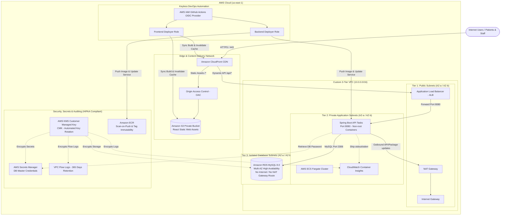

# 🏥 Hospital Management System - Enterprise AWS Infrastructure (Terraform)

[](https://www.terraform.io/)
[](https://aws.amazon.com/)
[](https://aws.amazon.com/compliance/hipaa-compliance/)
[](https://aws.amazon.com/fargate/)
[](https://aws.amazon.com/rds/)

> **Production-grade, HIPAA-compliant Infrastructure as Code (IaC)** for the **Horizon Health Partners (HHP)** hospital management platform, provisioned on Amazon Web Services (AWS) using modular Terraform.

---

## 🔗 Hospital System Ecosystem

This repository is the foundational cloud infrastructure layer of a three-tier decoupled microservices architecture:

| Repository | Tech Stack | Role |
| :--- | :--- | :--- |
| [🏗️ `hospital_terraform`](https://github.com/Dubemphil/hospital_terraform) | Terraform, AWS (VPC, ECS, RDS, CloudFront, KMS, OIDC) | Core Cloud Infrastructure & Security Foundation |
| [☕ `hospital_backend`](https://github.com/Dubemphil/hospital-system-backend) | Spring Boot (Java), MySQL, Docker, Maven | RESTful Healthcare API & Business Logic |
| [⚛️ `hospital_frontend`](https://github.com/Dubemphil/hospital-system-frontend) | React 18, HTML5/CSS3, Single-Page App | Patient & Staff Interactive Web Portal |

---

## 🏛️ High-Level Cloud Architecture



---

## 🔒 Security & HIPAA Compliance Control Matrix

This infrastructure is engineered to satisfy the rigorous technical safeguards mandated by **HIPAA (Health Insurance Portability and Accountability Act)** for safeguarding Protected Health Information (PHI):

| HIPAA Safeguard | Requirement | Implementation in this Architecture |
| :--- | :--- | :--- |
| **§ 164.312(a)(2)(iv)** | **Encryption at Rest** | Amazon RDS, AWS Secrets Manager, CloudWatch Logs, and S3 are encrypted using an **AWS KMS Customer Managed Key (CMK)** with automatic annual rotation enabled. |
| **§ 164.312(e)(1)** | **Transmission Security** | End-to-end TLS 1.2+ encryption. CloudFront enforces HTTPS redirects; RDS enforces `require_secure_transport = ON`. |
| **§ 164.312(b)** | **Audit Controls** | **VPC Flow Logs** and **CloudWatch Container Insights** record all network and API operations with a **365-day retention policy**. |
| **§ 164.312(a)(1)** | **Network Access Control** | **3-tier network segmentation**: The database resides in isolated subnets with zero route to the internet or NAT Gateway. Security Groups strictly chain traffic: `ALB SG -> ECS Fargate SG -> RDS SG`. |
| **DevOps Least-Privilege** | **Zero Static Credentials** | GitHub Actions authenticates via **OpenID Connect (OIDC)** temporary STS tokens; no permanent AWS access keys are stored in GitHub repository secrets. |

---

## 📁 Repository Structure

```
hospital_terraform/
├── .github/workflows/        # Automated GitHub Actions CI/CD (Plan & Apply via OIDC)
│   └── terraform-ci-cd.yml
├── main.tf                    # Root orchestration wiring all submodules
├── variables.tf               # Global input variables with validation
├── outputs.tf                 # Global outputs (ALB DNS, CloudFront, ECR, RDS, OIDC)
├── versions.tf                # AWS provider (~> 5.0) and Terraform (>= 1.5.0)
├── terraform.tfvars.example   # Example staging/production variable overrides
├── .gitignore                 # Production ignore protecting .terraform & *.tfvars
│
└── modules/
    ├── vpc/                   # 3-tier VPC, subnets across 2 AZs, NAT GW, Flow Logs
    ├── security/              # KMS CMK, Secrets Manager, chained Security Groups
    ├── rds/                   # Amazon RDS MySQL 8.0, Subnet Group, Parameter Group
    ├── ecr/                   # ECR with scan-on-push, lifecycle policy, KMS encryption
    ├── ecs/                   # ECS Fargate Cluster, Task Def, Service, ALB, Auto-scaling
    ├── frontend/              # S3 private bucket, CloudFront CDN with modern OAC
    └── oidc/                  # GitHub Actions OIDC Provider & Least-Privilege IAM Roles
```

---

## 🚀 Quickstart & Deployment Guide

### Prerequisites
1. [AWS CLI v2](https://docs.aws.amazon.com/cli/latest/userguide/install-cliv2.html) installed and configured with appropriate IAM credentials (`aws configure`).
2. [Terraform v1.5+](https://developer.hashicorp.com/terraform/downloads) installed.
3. Access to the [Dubemphil](https://github.com/Dubemphil) GitHub organization.

### 1. Clone & Configure
```bash
git clone https://github.com/Dubemphil/hospital-system-infra.git
cd hospital-system-infra

# Copy example variables
cp terraform.tfvars.example terraform.tfvars
```

Edit `terraform.tfvars` with your target settings:
```hcl
aws_region   = "us-east-1"
environment  = "staging"
project_name = "hospital-system"
db_name      = "dental_management_system"
github_org   = "Dubemphil"
```

### 2. Initialize & Validate
```bash
terraform init
terraform validate
```

### 3. Review Plan & Apply
```bash
terraform plan -out=tfplan
terraform apply tfplan
```

### 4. Post-Deployment Outputs
Upon successful application, Terraform outputs critical values used by the application repositories:
* `frontend_cdn_domain`: CloudFront public URL to access the React web interface.
* `ecr_repository_url`: ECR URI used by `hospital-system-backend` GitHub Actions to push images.
* `github_oidc_backend_role_arn`: ARN to configure in the backend GitHub Actions workflow.
* `github_oidc_frontend_role_arn`: ARN to configure in the frontend GitHub Actions workflow.

---

## 📄 License
This project is licensed under the MIT License.

